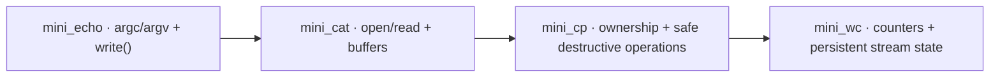

<div align="center">

# unix-toolbox

**Small Unix utilities rebuilt in C, one mechanism at a time.**


[](https://github.com/maximecoia/unix-toolbox/actions/workflows/ci.yml)
[](https://en.wikipedia.org/wiki/C99)

`mini_echo` → `mini_cat` → `mini_cp` → `mini_wc`

</div>

---

## About

`unix-toolbox` holds four small utilities. Each one is a single C99 file built on system calls.

It is a personal project, written after the 42 Piscine to learn C and Unix programming. It is not a school subject.

Every program has a deliberately small scope. That keeps the whole mechanism in view: inputs, state, control flow, system calls, failure paths and exact observable behavior.

The goal is not to clone the GNU or BSD commands. The goal is to rebuild a focused subset and understand what sits underneath.

## The sequence

Each utility reuses something from the one before and adds one new problem. All four are complete.



| Command | Data flow | What it adds |
|---|---|---|
| [`mini_echo`](mini_echo/) | `argv -> characters -> write()` | Argument traversal, separator placement and checked byte output. |
| [`mini_cat`](mini_cat/) | `path -> open() -> read() -> buffer -> stdout` | File descriptors, EOF, buffering and partial writes. |
| [`mini_cp`](mini_cp/) | `source fd -> buffer -> destination fd` | Two owned descriptors, same-file detection, regular-file validation and checks before `O_TRUNC`. |
| [`mini_wc`](mini_wc/) | `file -> buffer -> state transitions -> counters` | Stream-wide state, word boundaries, line, word and byte counts, manual number formatting and checked final output. |

Each folder has its own README with the behavior, the scope and the tests of that utility.

## Usage

```text
mini_echo [operand ...]
mini_cat file
mini_cp source destination
mini_wc file
```

`mini_wc` prints `lines words bytes filename`. Build first, then try them:

```sh
make
printf 'hello world\nsecond line\n' > /tmp/sample.txt
./bin/mini_echo hello unix world
./bin/mini_cat /tmp/sample.txt
./bin/mini_cp /tmp/sample.txt /tmp/copy.txt
./bin/mini_wc /tmp/copy.txt
```

The last four commands print:

```text
hello unix world
hello world
second line
2 4 24 /tmp/copy.txt
```

## Build

You need a C99 compiler, `make` and a POSIX shell. The code builds with `-Wall -Wextra -Werror -std=c99`. Binaries are written to `bin/`.

| Target | What it does |
|---|---|
| `make` | Builds the four utilities. |
| `make mini_wc` | Builds one utility. Works for each of the four names. |
| `make short` | Builds `bin/short/`: `mini_cat`, `mini_cp` and `mini_wc` with every `write()` cut to one byte. |
| `make read_fault` | Builds `bin/read_fault/mini_cp`, whose `read()` fails on demand. |
| `make test` | Builds everything, then runs the six suites. |
| `make check` | Checks the syntax of `tests/*.sh`, then runs `make test`. |
| `make status` | Prints `ACTIVE` or `TODO` for each utility. |
| `make clean` | Removes `bin/`. `make fclean` does the same. |
| `make re` | Cleans, then builds everything. |
| `make help` | Lists the targets. |

`short` and `read_fault` exist for the tests only.

`make status` reads one marker. A source file that contains `PROJECT_STATUS: TODO` shows as `TODO`, and its suite is skipped instead of failed. No source carries the marker now, so every utility shows `ACTIVE`.

## Test

Build and test everything:

```sh
make check
```

After the build lines, it prints:

```text
==> test_mini_echo.sh
PASS: mini_echo

==> test_mini_cat.sh
PASS: mini_cat

==> test_mini_cp.sh
PASS: mini_cp

==> test_mini_wc.sh
PASS: mini_wc

==> test_short_write.sh
PASS: short writes

==> test_read_fault.sh
PASS: read faults

Suites: 6 passed, 0 skipped, 0 failed
```

A suite stops at its first failed check and prints its label. So `PASS` means every check of that suite held.

To run one suite alone, build first, then call it with `sh`:

```sh
make
sh tests/test_mini_cat.sh
```

The two fault suites need `make short` and `make read_fault` first.

CI runs `make check` on Ubuntu and macOS for every push and pull request. Each job has a ten-minute limit.

## What the tests prove

A passing suite proves nothing until it has been seen to fail. Each utility was broken on purpose, one change at a time, and the suites ran again after `make clean`. Of fourteen changes, thirteen are caught. The measurement was first made on 2026-09-30 and repeated on 2026-10-19 with the same result.

The clean build matters. GNU make 3.81, the version macOS ships, compares timestamps to the second. A change saved in the same second as the last build is not compiled. The first run of this measurement caught nothing for that reason.

| Utility | What was broken | Caught by |
|---|---|---|
| `mini_echo` | the separator between operands dropped | `multiple operands output` |
| `mini_cat` | only the first `read()` kept | `text file bytes` |
| `mini_cat` | a failed `read()` taken for the end of the file | `directory operand` |
| `mini_cp` | the same-file check turned off | `same pathname` |
| `mini_cp` | the regular-file check turned off | `directory source preserves destination` |
| `mini_wc` | the word state reset at every `read()` | `word state survives buffer boundary` |
| `mini_wc` | a failed `read()` taken for the end of the file | `directory operand` |
| `mini_wc` | the tab no longer counted as whitespace | `whitespace counts` |
| `mini_cat` | a short write taken as complete | `mini_cat bytes under short writes` |
| `mini_cp` | a short write taken as complete | `mini_cp bytes under short writes` |
| `mini_wc` | a short write taken as complete | `mini_wc output under short writes` |
| `mini_cp` | a failed `read()` taken for the end of the file | `mini_cp read error` |
| `mini_cp` | an interrupted `read()` no longer retried | `mini_cp after an interrupted read` |

The two `directory operand` checks were added because the first measurement found the read error path untested. A directory passes `open()` and fails at `read()`. No earlier case reached it.

### Short writes

A real `write()` may return fewer bytes than it was asked for, on a pipe, a socket or a terminal. A shell test cannot make that happen on demand. So the loops that handle it had never run under test.

[`tests/short_write.c`](tests/short_write.c) is a stand-in for `write()` that writes one byte per call. `make short` rebuilds each utility with `-Dwrite=short_write`, so every call lands there. `mini_echo` already writes one byte per call and is left out. On the 2700-byte input of the suite, `mini_cat` makes 2025 shortened calls and still returns every byte.

The redirection happens at compile time. It does not use `LD_PRELOAD` or `DYLD_INSERT_LIBRARIES`, so it behaves the same on Linux and on macOS.

A stand-in that silently does nothing would let the suite pass for the wrong reason. So each shortened call is logged, and the suite fails when a utility made none. Building `bin/short/` without the redirection turns it red on `mini_cat shortened calls was empty`.

### Read faults

The read error of `mini_cp` needed the same trick. A directory is the usual way to make `read()` fail. It is refused before the copy starts, so no shell test reached that path.

[`tests/read_fault.c`](tests/read_fault.c) stands in for `read()`, and `make read_fault` rebuilds `mini_cp` with `-Dread=faulty_read`.

- With `READ_FAULT=eio`, the first call reads and every later one fails with `EIO`. The error lands after 1024 bytes are copied. `mini_cp` must exit non-zero and say why.
- With `READ_FAULT=eintr`, the first call fails with `EINTR`, as a signal would make it. The copy must still be whole.

Each injected fault is logged. Building `bin/read_fault/` without the redirection turns the suite red on `mini_cp read error returned status 0`.

A third wrong way, neither stopping on the error nor retrying it, makes `mini_cp` loop forever on the failing call. The suite then never ends instead of failing. That is why the CI job stops after ten minutes and not after GitHub's default of six hours.

### What still passes

One change still passes, and it is listed here rather than left to be found: **ignoring one write failure in `mini_echo`.**

After a permanent write error, the check on the final newline still fails, so the exit status stays right. Only a write that fails once and then recovers shows the difference. The byte is lost and the status is 0. No suite injects that.

## Repository structure

```text
unix-toolbox/
├── mini_echo/
│   ├── README.md
│   └── mini_echo.c
├── mini_cat/
│   ├── README.md
│   └── mini_cat.c
├── mini_cp/
│   ├── README.md
│   └── mini_cp.c
├── mini_wc/
│   ├── README.md
│   └── mini_wc.c
├── tests/
│   ├── common.sh            shared helpers and assertions
│   ├── run.sh               runs the six suites and counts them
│   ├── test_mini_echo.sh
│   ├── test_mini_cat.sh
│   ├── test_mini_cp.sh
│   ├── test_mini_wc.sh
│   ├── test_short_write.sh
│   ├── test_read_fault.sh
│   ├── short_write.c        write() stand-in, one byte per call
│   └── read_fault.c         read() stand-in, fails on demand
├── docs/
│   └── roadmap.md
├── .github/workflows/ci.yml
├── .editorconfig
├── .gitignore
├── LICENSE
├── Makefile
└── README.md
```

## Limits

Each utility stays inside a scope on purpose.

- `mini_echo` has no options. `-n` is printed as text. It does not interpret escape sequences.
- `mini_cat` takes exactly one file. It reads no standard input and does not treat `-` as standard input.
- `mini_cp` copies one regular file to one path. It does not recurse, copy special files, or keep modes, owners, timestamps or extended attributes. It does not replace the destination atomically.
- `mini_cp` does not guard against a race between `stat()` and the destination `open()`. A failing `close()` is not reported.
- `mini_wc` takes exactly one file. It has no flags, no `total` line and no standard input mode. Whitespace means the six C whitespace bytes, with no locale.
- Only `mini_cp` retries an interrupted `read()`. `mini_cat` and `mini_wc` stop with status 1. `mini_cat` also stops on an interrupted `write()`. No test injects `EINTR` into those two.
- Only `mini_cp` prints diagnostics. The other three exit with status 1 and say nothing.
- CI covers Ubuntu and macOS. Nothing else is tested.

## Project rules

- Keep each utility small enough to understand end to end.
- Derive control flow from the required behavior, not from remembered code.
- Check system calls instead of assuming success.
- Validate before destructive operations.
- Preserve stream-wide state across buffer boundaries.
- Test exact output, file contents, failure paths and exit status.
- Break each check on purpose before trusting it.
- Add abstractions only when they solve a real problem.

## What came next

[`docs/roadmap.md`](docs/roadmap.md) shows what each utility reuses and what it introduces.

The later work, a GPT trained from a blank file, then C, CUDA and inference engines, is traced in [`learning_tree-ML-systems`](https://github.com/maximecoia/learning_tree-ML-systems).

## License

MIT. See [`LICENSE`](LICENSE).
